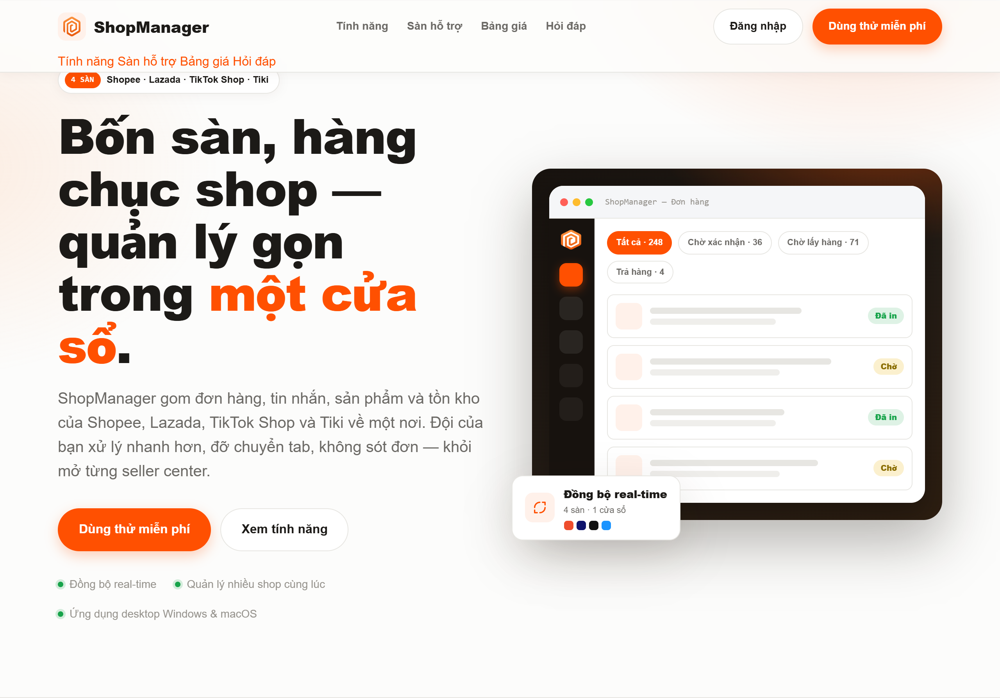
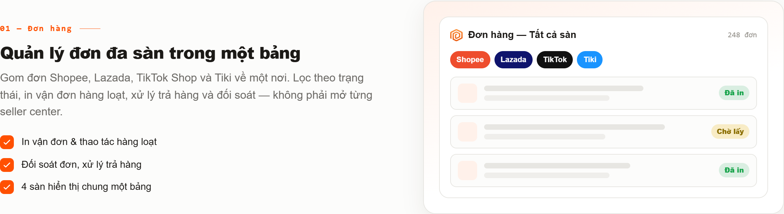
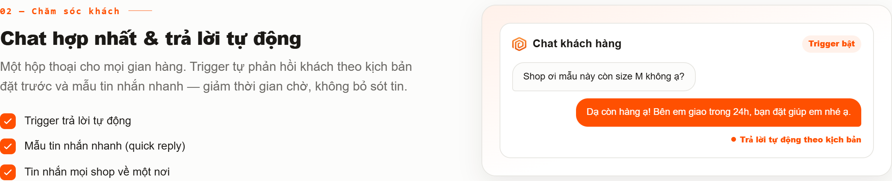
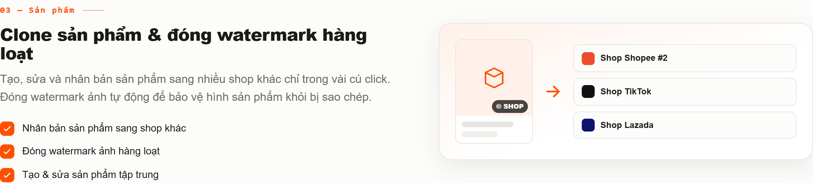
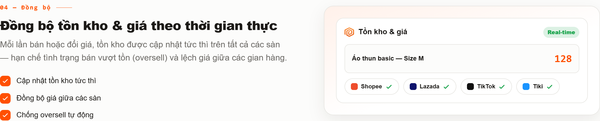
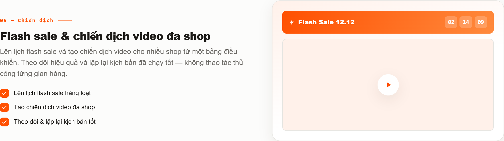
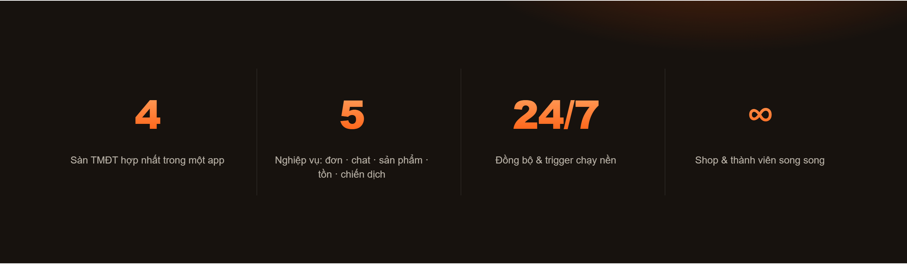

# ShopManager

**Quản lý bán hàng đa sàn trong một cửa sổ** — phần mềm desktop do [AutoShopee](https://autoshopee.com) phát triển.

[Tải về](#tải-về) · [Tính năng](#tính-năng) · [Hướng dẫn](#hướng-dẫn--hỗ-trợ) · [YouTube](https://www.youtube.com/autoshopee)

ShopManager gom đơn hàng, tin nhắn, sản phẩm và tồn kho của nhiều gian hàng về một chỗ. Mỗi shop đăng nhập trong một phiên seller riêng ngay trên máy của bạn, nên đội vận hành không phải mở từng seller center, đỡ chuyển tab và không sót đơn.

| Sàn | Hỗ trợ |
|---|:---:|
| Shopee | ✅ |
| TikTok Shop | ✅ |
| Lazada | ✅ |
| Tiki | ✅ |

## Tính năng

### Đơn hàng đa sàn trong một bảng

- Kéo đơn của tất cả shop về một bảng, lọc theo trạng thái.
- In vận đơn, thao tác hàng loạt, xử lý đơn hoàn / trả hàng.
- Cấu hình vận chuyển, theo dõi đơn hỏa tốc.

### Chat hợp nhất và trả lời tự động

- Tin nhắn của mọi shop về một hộp thoại.
- Trigger tự phản hồi theo kịch bản, mẫu tin nhắn nhanh.
- AI Agent hỗ trợ trả lời khách (Chat Agent, kết nối AI).

### Sản phẩm: sao chép, đẩy và watermark

- Sao chép sản phẩm giữa các shop, kể cả TikTok Shop → Shopee.
- Đẩy sản phẩm hàng loạt.
- Đóng watermark ảnh và PDF.

### Tồn kho và giá

- Theo dõi tồn kho tập trung, hạn chế bán vượt tồn.

### Flash sale và chiến dịch

- Lên lịch flash sale cho nhiều shop từ một màn hình.

### Công cụ khác

- **Shop của tôi**: quản lý danh sách shop, phiên đăng nhập riêng cho từng shop.
- **Proxy**: gán proxy theo shop.
- **Web Admin**: mở giao diện quản trị trên trình duyệt trong mạng nội bộ.

## Tải về

Vào trang [**Releases**](https://github.com/toannguyen1412/ShopManager/releases/latest) và chọn bản cài theo máy:

| Hệ điều hành | File |
|---|---|
| Windows 64-bit | `Shop-Manager-<phiên bản>-win-x64.exe` |
| Windows 32-bit | `Shop-Manager-<phiên bản>-win-ia32.exe` |
| Windows (tự chọn) | `Shop-Manager-<phiên bản>-win.exe` |
| macOS Apple Silicon (M1 trở lên) | `Shop-Manager-<phiên bản>-mac-arm64.dmg` |
| macOS Intel | `Shop-Manager-<phiên bản>-mac-x64.dmg` |

Ứng dụng tự cập nhật khi có bản mới. Bản đánh dấu *Pre-release* là bản thử nghiệm.

## Hướng dẫn & hỗ trợ

| | |
|---|---|
| Giới thiệu giải pháp | https://blog.autoshopee.com/gioi-thieu-tong-quan-ve-giai-phap/ |
| Cài đặt | https://support.autoshopee.com/shopmanager/cai-dat |
| Hướng dẫn sử dụng | https://support.autoshopee.com/shopmanager/quan-ly |
| Video | https://www.youtube.com/autoshopee |
| Trang chủ | https://autoshopee.com |

Đăng nhập ShopManager bằng tài khoản AutoShopee. Có gói dùng thử miễn phí; gói trả phí tính theo số shop và số thành viên.

## Câu hỏi thường gặp

**Có quản lý được nhiều shop cùng lúc không?**
Có. Đơn, tin nhắn và sản phẩm của mọi gian hàng được gom về một nơi, lọc và thao tác hàng loạt.

**Dữ liệu nằm ở đâu?**
Dữ liệu vận hành và phiên đăng nhập seller nằm trên máy của bạn. Captcha / OTP khi đăng nhập sàn do bạn tự xác nhận trong cửa sổ shop.

**Chạy trên hệ điều hành nào?**
Windows và macOS.

---

© AutoShopee · Repo này dùng để phát hành bản cài đặt ShopManager.

